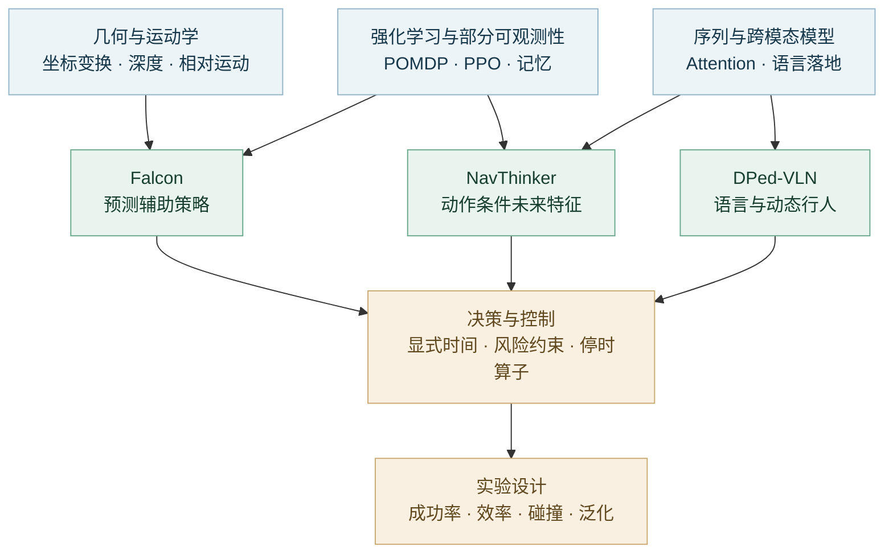

# Social Navigation · Reading Notes

**机器人如何看见人、预判人的运动，并在人群中完成导航？**

围绕 Falcon、NavThinker 和 DPed-VLN 的精读笔记，连接论文公式、实现细节与数学基础，延伸到世界模型、时序决策和安全控制。

[三篇论文](#三篇论文) · [阅读路线](#阅读路线) · [专题索引](#专题索引) · [复现代码与结果](https://github.com/liyuqin606-del/social-navigation-reproduction)

## 三篇论文

| 论文 | 研究问题 | 方法线索 | 笔记与原文 |
|---|---|---|---|
| **Falcon** | 点目标导航中，如何提前避让行人？ | 辅助未来预测、策略学习、社会惩罚 | [精读](research/falcon_notes.md) · [论文](https://doi.org/10.1109/ICRA55743.2025.11127910) |
| **NavThinker** | 不同动作将带来怎样的未来观测？ | 动作条件特征预测、未来信息融合 | [精读](research/navthinker_notes.md) · [论文](https://arxiv.org/abs/2603.15359v2) |
| **DPed-VLN** | 如何同时理解路线指令与动态行人？ | 跨模态策略、行人辅助任务、语言先验 | [精读](research/dped_notes.md) · [论文](https://arxiv.org/abs/2609.21504v1) |

Falcon 与 NavThinker 研究点目标社会导航；DPed-VLN 将语言指令引入动态行人环境。三篇笔记分别梳理任务输入、核心公式、实验设置和方法取舍。

## 阅读路线

| 阅读阶段 | 推荐材料 | 读完能回答什么 |
|---|---|---|
| **建立基础** | [前置知识与研究路线](output/三篇导航论文_前置知识与研究路线.md) · [PDF](output/三篇导航论文_前置知识与研究路线.pdf) | 观测、动作、奖励与预测各自承担什么作用？ |
| **逐篇拆解** | [Falcon](research/falcon_notes.md) → [NavThinker](research/navthinker_notes.md) → [DPed-VLN](research/dped_notes.md) | 未来信息如何进入策略，语言又改变了什么？ |
| **横向比较** | [数学／物理／World Model 调研](output/导航优化_数学物理WorldModel_文献调研_2026-11-03.md) · [PDF](output/pdf/导航优化_数学物理WorldModel_文献调研_2026-11-03.pdf) | 哪些经典模型和算法能迁移到社会导航？ |
| **形成实验** | [改进空间分析](research/headroom_audit_20261108/REPORT.md) · [复现仓库](https://github.com/liyuqin606-del/social-navigation-reproduction) | 如何把一个方法假设变成可比较的实验？ |

## 专题索引

| 主题 | 关注点 | 文档 |
|---|---|---|
| **数学建模** | 部分可观测决策、状态压缩、模型简化 | [数学专题](research/literature_2026-11-03/math_notes.md) · [建模推导](research/decision_world_model_20261104/ASTRA_MATHEMATICAL_MODELING.md) |
| **物理与几何** | 相对运动、碰撞几何、轨迹交互 | [专题笔记](research/literature_2026-11-03/physics_notes.md) |
| **世界模型** | 动作条件预测、表征、规划与模型偏差 | [专题笔记](research/literature_2026-11-03/worldmodel_notes.md) · [综合分析](research/literature_2026-11-03/synthesis.md) |
| **算法迁移** | 将导航子问题映射到成熟求解方法 | [算法分析](research/decision_world_model_20261104/ASTRA_ALGORITHM_MIGRATION.md) |
| **权重编辑** | 前向诊断、干预方向、补丁与回放 | [文献笔记](research/literature_2026-11-03/editing_notes.md) · [导航研究建议](output/权重编辑_导航研究建议.md) |
| **时间与安全** | 显式时间预测、约束、可达性 | [时间与安全](research/decision_world_model_20261104/EXPLICIT_TIME_AND_SAFETY.md) · [时序理论](research/sota_temporal_20261105/THEORY.md) · [扩展推导](research/sota_temporal_20261105/THEORY_ADVANCED.md) |
| **停时决策** | 闭环行为的持续时间、退出条件与可恢复性 | [SCET 审阅](research/scet_review_20261108/REVIEW.md) · [SCET-R 设计](research/headroom_audit_20261108/SCET_RECOVERABILITY_DESIGN.md) |

后三类包含研究设计与推导；对应实现和实测结果集中在[复现仓库](https://github.com/liyuqin606-del/social-navigation-reproduction)。

## 文献与版本

- [文献注册表](research/headroom_audit_20261108/literature/)：检索记录、来源链接及 BibTeX / RIS 等引用文件。
- [EXPORT_PROVENANCE.json](EXPORT_PROVENANCE.json)：笔记来源与文件哈希。
- [SHA256SUMS](SHA256SUMS)：当前快照的完整性校验。

笔记按各文档记录日期整理，最近归档于 **2026-11-08**。仓库收录精读、自编指南与研究草稿；论文原文通过上表链接访问。
